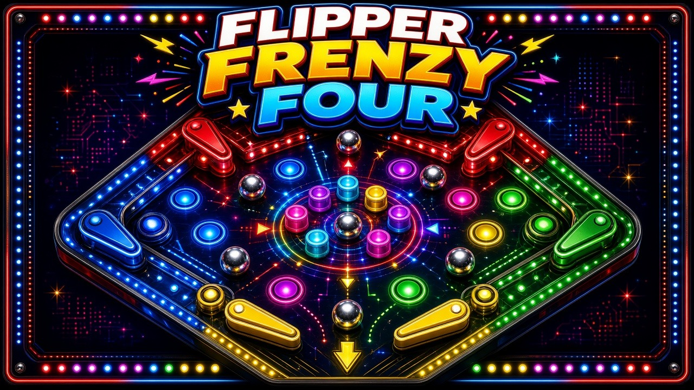

# Flipper Frenzy Four

Four-sided pinball on one shared screen. There is no downhill: a weak vortex tugs every ball toward the middle while each player guards a drain with a pair of flippers. Drain an opponent to take their life and a point. Last player standing takes the round. First to two rounds takes the match.

Play alone against bots or with up to four people on one keyboard. Gamepads hot-plug over the keyboard for that seat.

## Launch

The game is plain HTML, canvas, and JavaScript. A tiny Python 3 server on `127.0.0.1` serves it (default port **8817**, then the next free port) and opens your browser. No install and no network after the page loads.

| Platform | Launcher |
| --- | --- |
| macOS | Double-click `launch-mac.command` |
| Windows | Double-click `launch-windows.bat` |
| Linux | `./launch-linux.sh` |

Each launcher looks for Python 3 and tells you, in plain language, if it is missing.

From a terminal you can also run:

```bash
python3 server.py
```

Useful flags: `--port 8817` and `--no-browser`.

## Controls

Keyboard seats work with no gamepad connected.

| Player | Side | Move (nudge) | Left flipper | Right flipper |
| --- | --- | --- | --- | --- |
| P1 | Bottom | W A S D | F | G |
| P2 | Right | Arrow keys | / | . |
| P3 | Top | I J K L | ; | ' |
| P4 | Left | Numpad 8 4 5 6 | Numpad 0 | Numpad Enter |

Move keys tilt-nudge the whole table. Hold a nudge too long and that seat's flippers lock for a short tilt penalty.

| Gamepad | Action |
| --- | --- |
| Pads 0–3 | P1–P4 |
| Left stick or D-pad | Nudge |
| A | Left flipper |
| B | Right flipper |
| Start | Pause |

A connected pad replaces that player's keyboard until it is unplugged. The HUD shows a pad icon for each connected controller, including ones plugged in mid-match.

Esc pauses. M mutes. Enter confirms menus.

On the join screen, your action key takes a seat (or steps back to a bot). Your secondary key toggles an empty seat between bot and off. Unclaimed seats start as bots, so one human can play immediately. Enter starts when at least two seats are filled.

The controls screen remaps every keyboard binding. Settings change volume and how many round wins it takes to win the match (first to 2 by default). Both are saved in `localStorage`.

## Rules

The table is a square seen from above. Balls are pulled weakly toward the center. Bumpers, a spinner, and targets sit in the middle.

- Action is the left flipper. Secondary is the right flipper. "Left" and "right" are from that player's point of view, facing the center.
- Hitting a target with a ball you last touched grants one power-up:
  - **Multiball** — another ball enters immediately (up to five on the table).
  - **Wide flippers** — for 10 seconds.
  - **Drain shield** — your drain bounces balls for 8 seconds.
- Each player starts a round with **10 lives**.
- A ball that leaves through your drain costs you 1 life and gives **1 point** to whoever last touched it.
- At 0 lives your drain is walled off and you are out of the round.
- Balls are added over time until **1 to 3** are in play. Multiball can go past that, up to five.
- The last player alive wins the round.
- First to **2** round wins takes the match. Change that count in Settings.
- Standings rank round wins, then points.

## arcade.json

`arcade.json` is the manifest for an arcade launcher: display name, id, icon, cover, per-platform launch commands, the web entry, player count, default port, and accepted inputs.

```json
{
  "name": "Flipper Frenzy Four",
  "id": "flipperfrenzyfour",
  "icon": "assets/icon.jpg",
  "cover": "assets/cover.jpg",
  "launch": { "mac": "./launch-mac.command", "windows": "launch-windows.bat", "linux": "./launch-linux.sh", "web": "index.html" },
  "players": 4,
  "port": 8817,
  "minPlayers": 1,
  "input": ["keyboard", "gamepad"],
  "version": "1.0.0"
}
```

## Tests

Core rules, physics, input mapping, and the manifest are tested with Node's built-in runner. No packages to install. A Python smoke test checks that the server serves the page.

```bash
node --test tests/
python3 tests/test_server.py
```

GitHub Actions runs both on push and pull request.

## License

[MIT](LICENSE)
